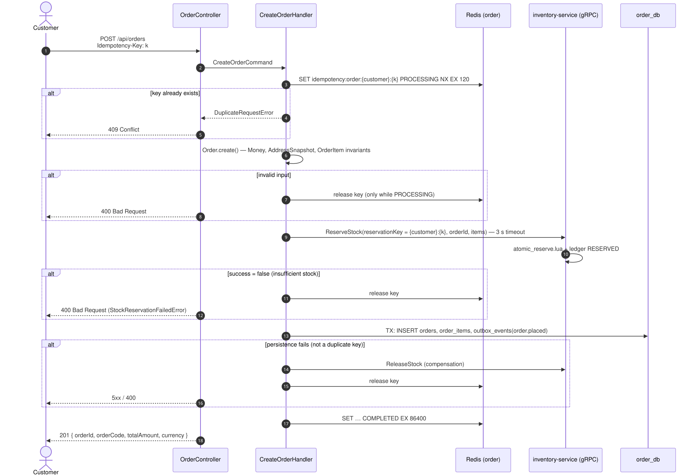

# 01 — Place order

## Business narrative

A customer checks out a cart. The answer must come back immediately:

- **201 Created**: every line is reserved and the order is `PENDING`.
- **400**: stock is insufficient or the input is invalid.

Retrying the same checkout (same `Idempotency-Key`) must never create a second order or reserve stock twice.
Reserved stock is held for `RESERVATION_TTL_SECONDS` (15 min by default) until the order ships (flow 02).
If the order never ships in that time, the reservation expires (flow 04).

## Domain message flow (DDD Crew)

## Sequence

## Inventory side of `ReserveStock`

## Rules and edge cases

| Situation | Behaviour |
|---|---|
| Same key retried while the first call is still running | 409 (`PROCESSING` lock) |
| Same key retried after success | 409 — the key is `COMPLETED` for 24 h; DB `UNIQUE (customer_id, idempotency_key)` is the backstop |
| Same key from another customer | Independent: keys are scoped by `customerId` |
| Crash after reservation, before the DB commit | Lock expires after 120 s; reservation expires after 15 min (flow 04) |
| Duplicate-key error on insert | No compensation: the reservation belongs to the order already stored |
| Concurrency | 200 parallel 1-unit orders against 100 units → exactly 100 × 201 |
| Lines | One line per SKU, quantity > 0, same currency; prices are fixed-point (4 decimals) |
