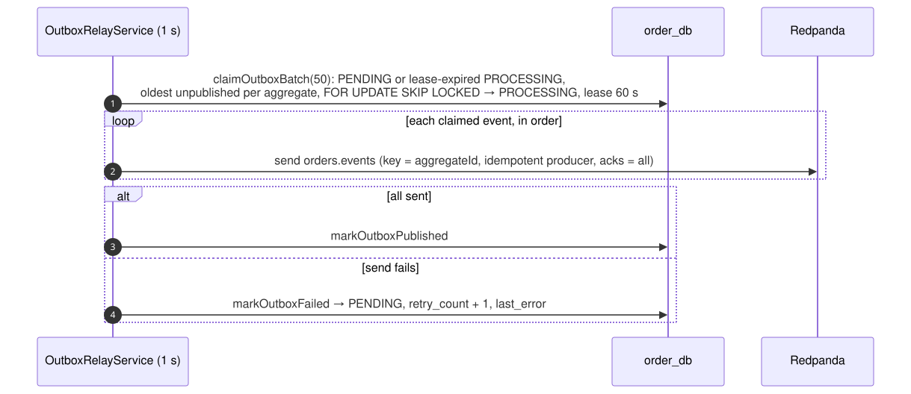
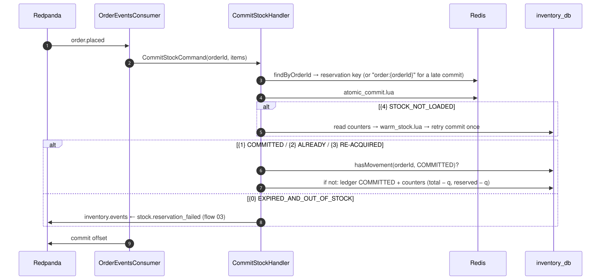

# 02 — Ship the stock of a placed order

## Business narrative

Once an order is stored, its reserved units become shipped units: they leave both the `total` and the
`reserved` counters. This happens asynchronously through the `order.placed` event, so checkout latency
does not include it.

Delivery is at-least-once, so the same event may arrive several times. It may also arrive after the
reservation expired: Kafka or the relay was down for longer than the TTL. In that case inventory tries to
take the stock again. If the stock is gone, inventory tells Ordering (flow 03).

## Domain message flow (DDD Crew)

## Sequence — outbox relay (order-service)

## Sequence — commit (inventory-service)

## `atomic_commit.lua` decision

## Rules and edge cases

| Situation                                   | Behaviour                                                                                 |
| ------------------------------------------- | ----------------------------------------------------------------------------------------- |
| Redelivered `order.placed`                  | `{2}` from Redis; the ledger already has `COMMITTED` → no-op                              |
| Crash between Redis commit and ledger write | Redelivery returns `{2}` and reconciles the ledger (`hasMovement` + partial unique index) |
| Ordering of events per order                | Same partition (key = `orderId`) and the outbox claims one event per aggregate at a time  |
| Malformed payload                           | Domain validation fails → logged and skipped (no poison-pill loop)                        |
| `order.confirmed` / `order.cancelled`       | Ignored by inventory today (see limitations in `system-design.md`)                        |
