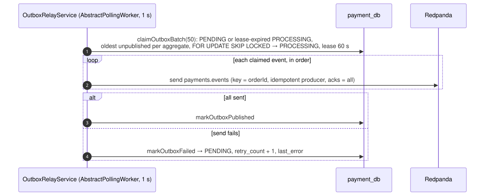

# 02 — Ship the stock of a paid order

## Business narrative

Stock leaves the warehouse only once the order is paid. When the payment becomes PAID (flow 09), the
payment-service publishes `payment.succeeded` through its outbox; the inventory then turns the reserved units into
shipped units: they leave both the `total` and the `reserved` counters. Ordering confirms the order from the same
event (flow 09).

Delivery is at-least-once, so the same event may arrive several times. It may also arrive after the
reservation expired: the customer paid late, or Kafka was down for longer than the TTL. The event carries the
order lines, so inventory tries to take the stock again. If the stock is gone, inventory tells Ordering (flow 03).

## Domain message flow (DDD Crew)

## Sequence — outbox relay (payment-service)

## Sequence — commit (inventory-service)

## `atomic_commit.lua` decision

## Rules and edge cases

| Situation                                   | Behaviour                                                                                 |
| ------------------------------------------- | ----------------------------------------------------------------------------------------- |
| Redelivered `payment.succeeded`             | `{2}` from Redis; the ledger already has `COMMITTED` → no-op                              |
| Redelivered after Redis forgot the order    | Reservation record expired (7 days) or Redis lost → the ledger is checked first → no-op   |
| Infrastructure error                        | Retried with backoff, then parked in `payments.events.dlq`; offset committed manually     |
| Crash between Redis commit and ledger write | Redelivery returns `{2}` and reconciles the ledger (`hasMovement` + partial unique index) |
| Ordering of events per order                | Same partition (key = `orderId`) and the outbox claims one event per aggregate at a time  |
| Malformed payload                           | Domain validation fails → logged and skipped (no poison-pill loop)                        |
| `order.placed`                              | No longer consumed by inventory: nothing ships before the payment                         |
