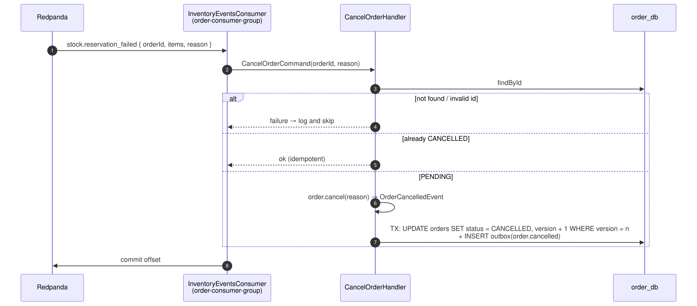

# 03 — Cancel an order when its stock is gone

## Business narrative

Sometimes `order.placed` reaches inventory after the reservation has expired, and other customers have
bought the units in the meantime. The order was accepted but cannot be fulfilled. Inventory publishes
`stock.reservation_failed` with reason `EXPIRED_OUT_OF_STOCK`. Ordering then cancels the order, which
emits `order.cancelled` through its outbox.

## Domain message flow (DDD Crew)

## Sequence

## Order status lifecycle

## Rules and edge cases

| Situation                                     | Behaviour                                                                      |
| --------------------------------------------- | ------------------------------------------------------------------------------ |
| Redelivered event                             | Order already `CANCELLED` → no-op                                              |
| Order not `PENDING` (for example `CONFIRMED`) | `InvalidOrderStatusTransitionError` → logged and skipped                       |
| Concurrent update                             | Optimistic `version` check; the losing write throws and Kafka redelivers       |
| Publishing `stock.reservation_failed` fails   | Inventory rethrows, `order.placed` is redelivered and re-evaluated             |
| Customer notification                         | Not implemented: a future notification service would consume `order.cancelled` |
