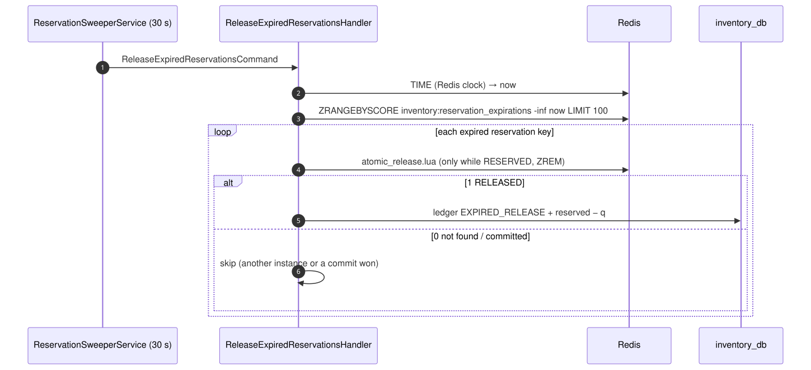

# 04 — Expire abandoned reservations

## Business narrative

Sometimes stock is reserved but the order is never stored. The client may have gone away, the order
service may have crashed, or compensation itself may have failed. Those units must not stay locked
forever. After `RESERVATION_TTL_SECONDS` (900 s by default) an uncommitted reservation is released and
the units become available again.

## Domain message flow (DDD Crew)

## Sequence

## Why the ZSET, not key TTLs

| Choice                                      | Reason                                                                           |
| ------------------------------------------- | -------------------------------------------------------------------------------- |
| Expiry is a ZSET score, not a Redis key TTL | A TTL would delete the hash before the sweeper could read which units to release |
| Hash retention of 7 days                    | Garbage collection only, far beyond the 15-minute business TTL                   |
| Redis `TIME` instead of the Node clock      | One clock for every instance                                                     |
| Release script checks status                | Several sweepers, or a sweeper racing a commit, release at most once             |

The same `atomic_release.lua` also serves the compensating `ReleaseStock` gRPC call from flow 01, which
records `RELEASED` instead of `EXPIRED_RELEASE`.
