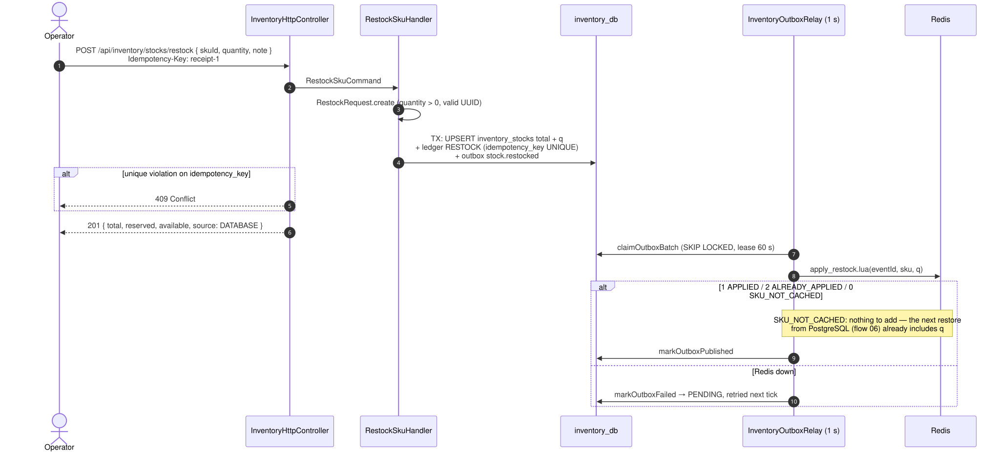

# 05 — Restock a SKU

## Business narrative

A warehouse operator records a goods receipt: N more units of a SKU. The receipt must be durable
immediately and applied to sellable stock (Redis) **exactly once**, even if Redis is down at that moment
or the request is retried. An unknown SKU is created with nothing reserved.

## Domain message flow (DDD Crew)

## Sequence

## Exactly-once application

`apply_restock.lua` performs `SET inventory:applied_restock:{eventId} NX EX 30d` and `HINCRBY total q`
in one atomic script. A relay crash after Redis but before `markOutboxPublished` leads to a redelivery,
and the script then returns `2 ALREADY_APPLIED`.

`warm_stock.lua` restores a hash from a PostgreSQL snapshot, and that snapshot already contains every
committed receipt. It reads the snapshot at REPEATABLE READ together with the ids of the pending
`stock.restocked` events, and marks those ids as applied. A pending receipt is therefore never counted
twice.

## Rules and edge cases

| Situation | Behaviour |
|---|---|
| Redis down during restock | 201 is still returned; the relay applies the receipt when Redis is back |
| Same `Idempotency-Key` retried | 409, nothing applied twice |
| Several receipts for one SKU | Applied in order: the claim takes the oldest unpublished event per aggregate |
| Concurrent checkout | `HINCRBY total` is atomic with the reserve scripts |
