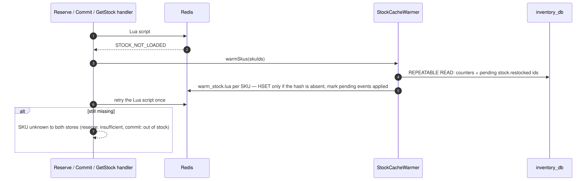
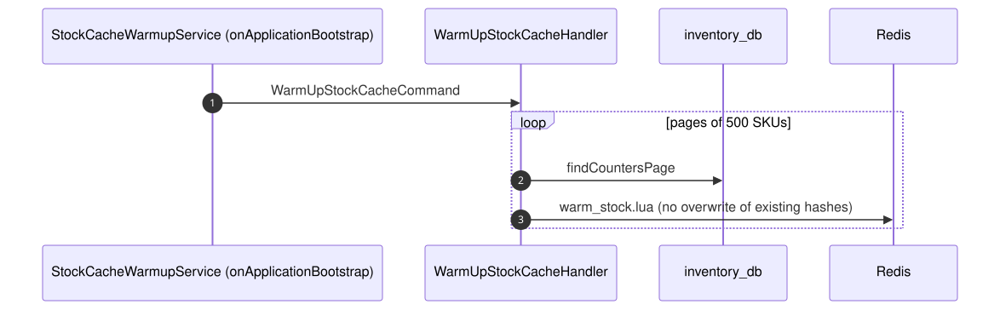

# 06 — Recover the stock cache

## Business narrative

Redis holds the live stock counters used by checkout. If Redis loses them (flush, failover without
persistence, new instance), customers must not see false "out of stock" answers. Accepted orders must
not be cancelled either. PostgreSQL holds the durable counters, so the cache is rebuilt from it:

- **eagerly** at startup;
- **lazily** whenever a Lua script reports a missing SKU.

## Domain message flow (DDD Crew)

## Sequence — lazy recovery

## Sequence — eager warm-up

## Rules and edge cases

| Situation | Behaviour |
|---|---|
| Hash already present | Never overwritten: Redis may be ahead of PostgreSQL by in-flight reservations |
| Warm-up running concurrently with a restock | Snapshot + pending markers keep it exact (see flow 05) |
| Whole Redis lost | Counters recover; **active reservations are lost**, so their units stay counted as reserved in PG (known limitation) |
| Disable | `STOCK_CACHE_WARMUP_ENABLED=false` disables only the eager path; the lazy path always runs |
