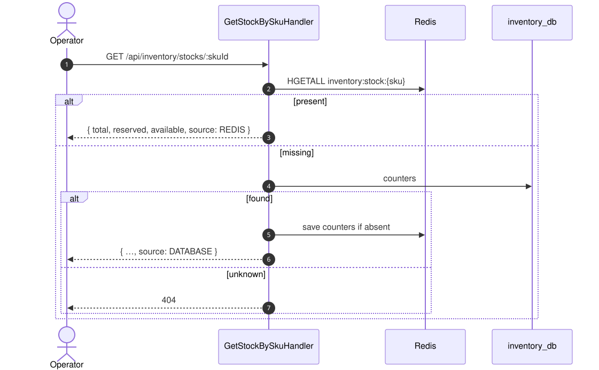

# 07 — Query orders and stock

## Business narrative

Customers look up an order or list their orders. Operators check the sellable stock of a SKU and its
movement history. The read side uses dedicated query handlers and read ports (CQRS). It never loads
aggregates and never changes state, with one exception: a stock read may repopulate a missing Redis hash.

## Domain message flow (DDD Crew)

## Endpoints

| Endpoint | Query | Source | Errors |
|---|---|---|---|
| `GET /api/orders/:id` | `GetOrderByIdQuery` | order_db via `OrderReadPort` | 404 `OrderNotFoundError`, 400 invalid UUID |
| `GET /api/orders?customerId=&page=&limit=` | `GetOrdersByCustomerQuery` | order_db, newest first | 400 invalid paging |
| `GET /api/inventory/stocks/:skuId` | `GetStockBySkuQuery` | Redis, fallback PostgreSQL | 404 unknown SKU |
| `GET /api/inventory/stocks/:skuId/ledger` | `GetStockLedgerQuery` | inventory_db, 50 newest movements | — |

## Sequence — stock level

`source` tells which store answered. Redis is authoritative for sellable stock. PostgreSQL may briefly lag
behind it: a ledger write follows each Lua script, and a pending restock may not be applied to Redis yet.

## Known gaps

- No authentication: anyone can list any customer's orders by `customerId` (see `system-design.md` §10).
