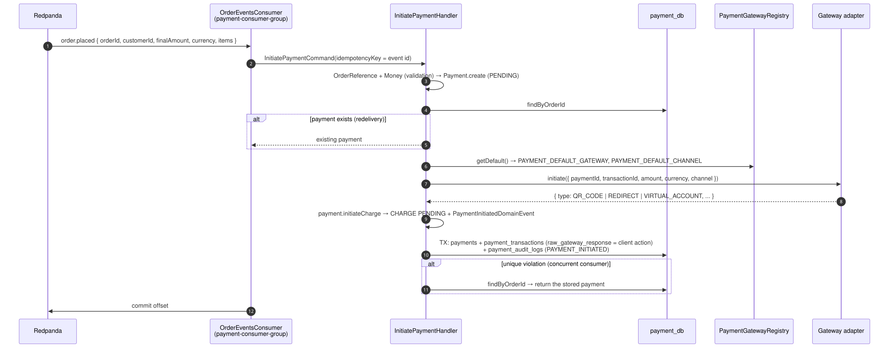

# 08 — Open the payment of an order

## Business narrative

As soon as an order is placed, the customer must be able to pay. The payment-service consumes `order.placed`,
creates the Payment aggregate (`PENDING`, total amount fixed for ever) and opens the first CHARGE at the configured
gateway (`PAYMENT_DEFAULT_GATEWAY`, default MOCK) and channel (`PAYMENT_DEFAULT_CHANNEL`, default QR_CODE). The
gateway answers with what the customer must do: follow a redirect, scan a QR code or transfer to a virtual account.
The storefront reads it from `GET /api/payments/orders/:orderId` (`clientAction`).

The charge UUID is the merchant reference sent to the gateway; the gateway echoes it in its webhook (flow 09).

## Domain message flow (DDD Crew)

## Sequence

## Rules and edge cases

| Situation                          | Behaviour                                                                                         |
| ---------------------------------- | ------------------------------------------------------------------------------------------------- |
| Redelivered `order.placed`         | The order already has a payment → returned as is; no second gateway call                          |
| Two consumers race                 | `payments.order_id` / ledger key `charge:{eventId}` UNIQUE → the loser returns the stored payment |
| Invalid order data                 | Domain validation fails (UUIDs, positive amount, ISO currency, lines) → logged and skipped        |
| Store fails after the gateway call | The checkout session at the gateway expires unused; Kafka redelivers and a new one is opened      |
| Audit                              | `PAYMENT_INITIATED` (actor SYSTEM) is written in the same transaction                             |
