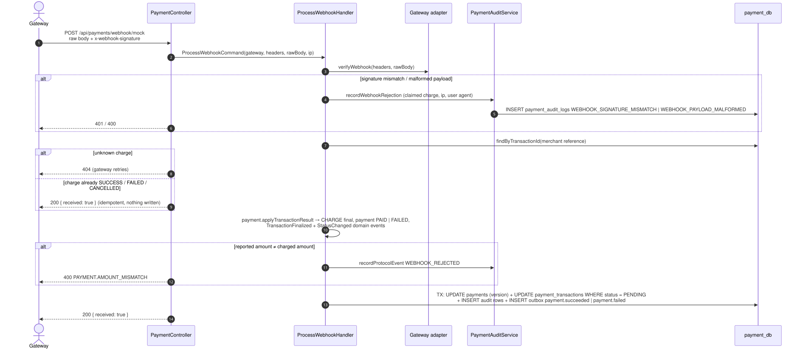

# 09 — Gateway webhook: payment result

## Business narrative

Gateways report results asynchronously: the customer pays at the gateway, then the gateway calls
`POST /api/payments/webhook/:gateway` (`mock`, `vnpay`, `vietqr-va`). Nothing in a webhook is trusted until the
adapter of that gateway has verified its signature over the **raw** body (MOCK / VietQR: HMAC-SHA256 header; VNPay:
HMAC-SHA512 `vnp_SecureHash`). Gateways retry until they get a 200, so the endpoint is idempotent.

A verified SUCCESS that captures the charged amount makes the payment PAID and publishes `payment.succeeded`
(order CONFIRMED, stock committed — flow 02). FAILED or CANCELLED makes it FAILED and publishes `payment.failed`
(flow 10). In development, `POST /api/payments/mock-gateway/pay` builds and signs the MOCK webhook and processes it
through the same path.

## Domain message flow (DDD Crew)

## Sequence

## Payment status lifecycle

## Rules and edge cases

| Situation                                   | Behaviour                                                                                         |
| ------------------------------------------- | ------------------------------------------------------------------------------------------------- |
| Bad or missing signature                    | 401; `WEBHOOK_SIGNATURE_MISMATCH` with caller IP and masked payload in the claimed payment's log  |
| Signed but malformed payload                | 400; `WEBHOOK_PAYLOAD_MALFORMED`                                                                  |
| Charge already final (retry, contradiction) | 200, nothing changes: a final ledger entry is immutable (domain + database trigger)               |
| Concurrent deliveries                       | Optimistic version: the loser gets 409, the gateway's retry is then acknowledged                  |
| Captured amount ≠ charged amount            | 400 `PAYMENT.AMOUNT_MISMATCH`, `WEBHOOK_REJECTED` recorded, payment stays PENDING                 |
| Webhook before `order.placed` was consumed  | 404 `PAYMENT.NOT_FOUND`; the gateway retries                                                      |
| Reference matches no payment at all         | Rejection only logged by the application (every activity row belongs to a payment)                |
| Atomicity                                   | Payment, ledger entry, `TRANSACTION_FINALIZED` + `STATE_CHANGED` rows and outbox: one transaction |
