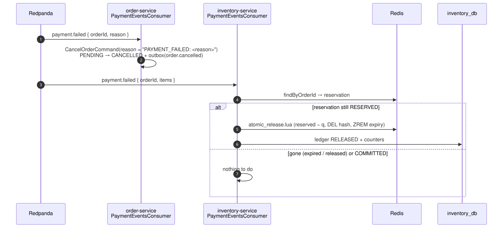

# 10 — Payment failed: cancel the order and release the stock

## Business narrative

When the gateway reports a declined or cancelled payment (flow 09), the order can no longer be fulfilled and its
reserved units must go back on sale immediately rather than after the 15-minute reservation expiry. The
payment-service publishes `payment.failed`; Ordering cancels the order and Inventory releases the reservation
with `atomic_release.lua`.

## Domain message flow (DDD Crew)

## Sequence

## Rules and edge cases

| Situation                       | Behaviour                                                                                |
| ------------------------------- | ---------------------------------------------------------------------------------------- |
| Redelivered `payment.failed`    | Order: event already in `inbox_events` → skipped; inventory: reservation gone → no-op    |
| Order no longer PENDING         | Inbox row recorded, refusal logged; the offset is committed                              |
| Reservation already expired     | Nothing to release (the sweeper did it)                                                  |
| Reservation already `COMMITTED` | Not released (cannot happen for one payment: SUCCESS and FAILED are mutually exclusive)  |
| Consumer groups                 | `order-payment-consumer-group` and `inventory-payment-consumer-group` read independently |
| Cancellation reason             | `PAYMENT_FAILED: <gateway reason>`, e.g. `PAYMENT_FAILED: CARD_DECLINED`                 |
