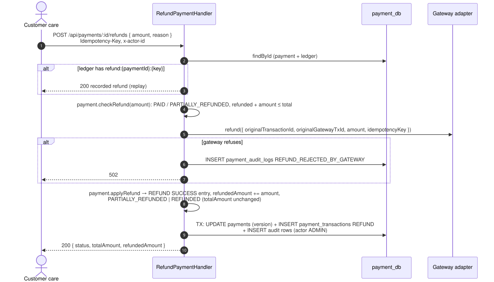

# 11 — Refund a payment

## Business narrative

Customer care refunds part or all of a paid payment, e.g. for a damaged item. The refund goes through the gateway
of the successful charge; once the gateway confirms it, a SUCCESS REFUND entry is appended to the ledger and
`refundedAmount` grows. The `totalAmount` owed never changes: the payment becomes PARTIALLY_REFUNDED, then REFUNDED
when the refunds reach the total. Every step is in the activity log with the operator (`x-actor-id`) and IP,
readable at `GET /api/payments/:id/activities`.

## Domain message flow (DDD Crew)

## Sequence

## Rules and edge cases

| Situation                                        | Behaviour                                                                                    |
| ------------------------------------------------ | -------------------------------------------------------------------------------------------- |
| Payment not PAID / PARTIALLY_REFUNDED            | 400 `PAYMENT.INVALID_STATE`, checked before calling the gateway                              |
| Refunds would exceed the total                   | 400 `PAYMENT.REFUND_EXCEEDS_TOTAL` (domain) — also a CHECK constraint in PostgreSQL          |
| Same `Idempotency-Key` replayed                  | Returns the recorded refund; ledger key `refund:{paymentId}:{key}`, key forwarded to gateway |
| Same key, two requests at once                   | One wins; the other gets 409                                                                 |
| Gateway refuses                                  | 502 `PAYMENT.GATEWAY_REFUND_FAILED`, `REFUND_REJECTED_BY_GATEWAY` recorded                   |
| Gateway without refunds (VietQR, VNPay skeleton) | 501 `PAYMENT.GATEWAY_OPERATION_NOT_SUPPORTED`                                                |
| Events                                           | Refunds are audited but not published to Kafka yet; stock is not restocked on refund         |
