# Message flows

Each business feature has its own page. It contains the business narrative, a
[DDD Crew Domain Message Flow](https://github.com/ddd-crew/domain-message-flow-modelling) diagram, a
technical sequence diagram, and the rules and edge cases the code enforces.
Architecture, the C4 model and the data model are in [`../system-design.md`](../system-design.md).

Diagrams are SVG images rendered from Mermaid sources in [`diagrams/`](./diagrams/), one folder per page.
To change one, edit its `.mmd` file and run `tools/docs/render-diagrams.sh <file.mmd>`. With no argument,
the script re-renders every diagram.

| #   | Feature                                                                        | Trigger                          | Bounded contexts             |
| --- | ------------------------------------------------------------------------------ | -------------------------------- | ---------------------------- |
| 01  | [Place order](./01-place-order.md)                                             | Customer checkout                | Ordering → Inventory (gRPC)  |
| 02  | [Ship stock of a placed order](./02-commit-stock.md)                           | `order.placed`                   | Ordering → Inventory (Kafka) |
| 03  | [Cancel order when stock is gone](./03-cancel-order-on-reservation-failure.md) | `stock.reservation_failed`       | Inventory → Ordering (Kafka) |
| 04  | [Expire abandoned reservations](./04-reservation-expiry.md)                    | Time (sweeper)                   | Inventory                    |
| 05  | [Restock a SKU](./05-restock.md)                                               | Warehouse operator               | Inventory                    |
| 06  | [Recover the stock cache](./06-stock-cache-recovery.md)                        | Startup / missing Redis counters | Inventory                    |
| 07  | [Query orders and stock](./07-queries.md)                                      | Customer / operator              | Ordering, Inventory          |

## Notation (DDD Crew Domain Message Flow)

DDD Crew diagrams show **actors** and **bounded contexts** as boxes. Numbered arrows between them carry
one message each. Messages are colour-coded by kind:

Edge labels are written as `n. <kind>: <message>`. Each label also names the transport:
`REST`, `gRPC`, `Kafka`, or `internal` (a worker or timer inside the context).

## Big picture — every domain message

## Message catalogue

| Message                             | Kind             | Producer                  | Consumer               | Transport                | Contract                                         |
| ----------------------------------- | ---------------- | ------------------------- | ---------------------- | ------------------------ | ------------------------------------------------ |
| `CreateOrderCommand`                | command          | OrderController           | CreateOrderHandler     | in-process               | `apps/order-service/.../create-order.command.ts` |
| `ReserveStock`                      | command          | order-service             | inventory-service      | gRPC                     | `libs/proto/inventory.proto`                     |
| `ReleaseStock`                      | command          | order-service             | inventory-service      | gRPC                     | `libs/proto/inventory.proto`                     |
| `order.placed`                      | event            | order-service outbox      | inventory-service      | Kafka `orders.events`    | `OrderPlacedPayload`                             |
| `order.confirmed`                   | event            | order-service outbox      | — (not consumed yet)   | Kafka `orders.events`    | `OrderConfirmedPayload`                          |
| `order.cancelled`                   | event            | order-service outbox      | — (not consumed yet)   | Kafka `orders.events`    | `OrderCancelledPayload`                          |
| `stock.reservation_failed`          | event            | inventory-service         | order-service          | Kafka `inventory.events` | `StockReservationFailedPayload`                  |
| `stock.restocked`                   | event (internal) | inventory outbox          | inventory outbox relay | PostgreSQL → Redis       | `StockRestockedPayload`                          |
| `CommitStockCommand`                | command          | OrderEventsConsumer       | CommitStockHandler     | in-process               | —                                                |
| `CancelOrderCommand`                | command          | InventoryEventsConsumer   | CancelOrderHandler     | in-process               | —                                                |
| `ReleaseExpiredReservationsCommand` | command          | ReservationSweeperService | handler                | in-process               | —                                                |
| `RestockSkuCommand`                 | command          | InventoryHttpController   | RestockSkuHandler      | in-process               | —                                                |
