# System Design — NestJS E-commerce (Order, Inventory & Payment)

> Status: reflects the code on branch `feat/payment-service`.
> Per-feature message flows live in [`message-flows/`](./message-flows/README.md).

## 1. Scope and goals

The system takes customer orders, collects their payment through a gateway and guarantees that **stock is
never oversold** and **money is never lost or counted twice**, even under concurrent checkouts, crashes, retries,
duplicate webhooks and partial outages of Redis or Kafka.

| Goal                             | How it is achieved                                                                                   |
| -------------------------------- | ---------------------------------------------------------------------------------------------------- |
| No overselling under concurrency | Stock checks and changes run as atomic Lua scripts on Redis (CLAUDE.md §3.1)                         |
| No lost or phantom events        | Transactional outbox in every service (CLAUDE.md §3.2)                                               |
| Safe retries                     | `Idempotency-Key` on state-changing requests, Redis `SET NX EX` + DB unique keys (§3.3)              |
| Service autonomy                 | Database per service, no cross-service joins or FKs, logical UUIDs and JSON snapshots (§3.4)         |
| Pay before shipping              | Saga choreography: stock is committed on `payment.succeeded`, released at once on `payment.failed`   |
| Tamper-proof money records       | Append-only payment ledger and activity log, enforced by PostgreSQL triggers; HMAC-verified webhooks |
| No stuck stock                   | Reservations expire (ZSET + sweeper) unless the order is paid and committed                          |
| Recoverable cache                | Redis counters are restored from PostgreSQL on demand and at startup                                 |

Out of scope today: customers/catalog services, authentication, shipping, notifications.

## 2. Bounded contexts

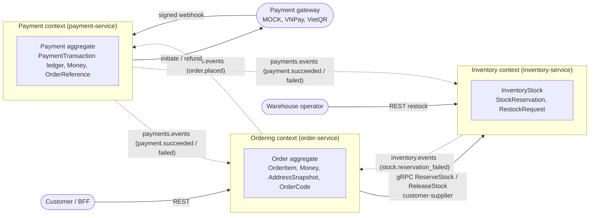

| Relationship                           | Pattern                                                                                |
| -------------------------------------- | -------------------------------------------------------------------------------------- |
| Ordering → Inventory (reserve/release) | Synchronous customer–supplier over gRPC, contract in `libs/proto/inventory.proto`      |
| Ordering ⇄ Payment ⇄ Inventory         | Saga choreography over Kafka; published language `@org/contracts` (payloads, envelope) |
| Payment → gateways                     | Anticorruption layer: one adapter per provider behind `PaymentGatewayPort` (strategy)  |
| Shared kernel                          | `@org/shared-domain` (ValueObject, Entity, AggregateRoot, Result, DomainError)         |

## 3. C4 model

### 3.1 Level 1 — System context

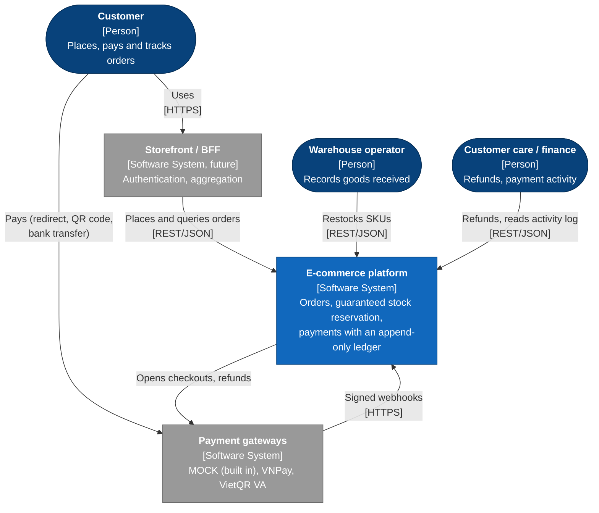

### 3.2 Level 2 — Containers

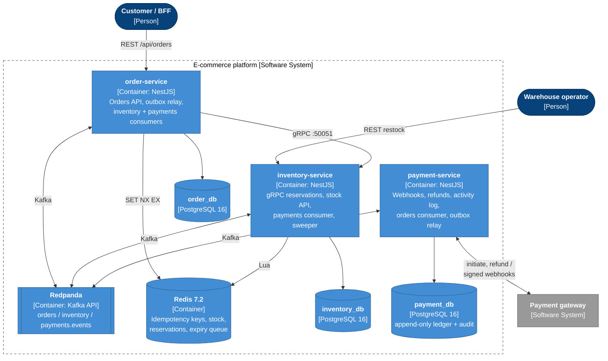

| Container          | Inbound                                                            | Outbound                                           | Ports (local)                              |
| ------------------ | ------------------------------------------------------------------ | -------------------------------------------------- | ------------------------------------------ |
| order-service      | REST `/api/orders`, `inventory.events`, `payments.events`          | gRPC → inventory, `orders.events`, order_db, Redis | HTTP 3100 (debug 9229)                     |
| inventory-service  | gRPC `InventoryService`, REST `/api/inventory`, `payments.events`  | `inventory.events`, inventory_db, Redis            | HTTP 3200, gRPC 50051 (debug 9230)         |
| payment-service    | REST `/api/payments` (webhooks, refunds, queries), `orders.events` | gateways, `payments.events`, payment_db            | HTTP 3300 (debug 9231)                     |
| PostgreSQL         | —                                                                  | —                                                  | 5433 (host), 5432 (compose network)        |
| Redis              | —                                                                  | —                                                  | 6379                                       |
| Redpanda / Console | —                                                                  | —                                                  | 9092 (host), 29092 (compose), Console 8088 |

Every HTTP service serves Swagger at `/api/docs` and `/api/docs-json` (`SWAGGER_ENABLED`).

### 3.3 Level 3 — Components of order-service

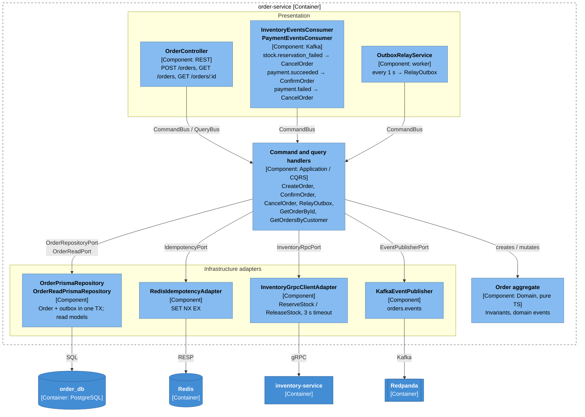

### 3.4 Level 3 — Components of inventory-service

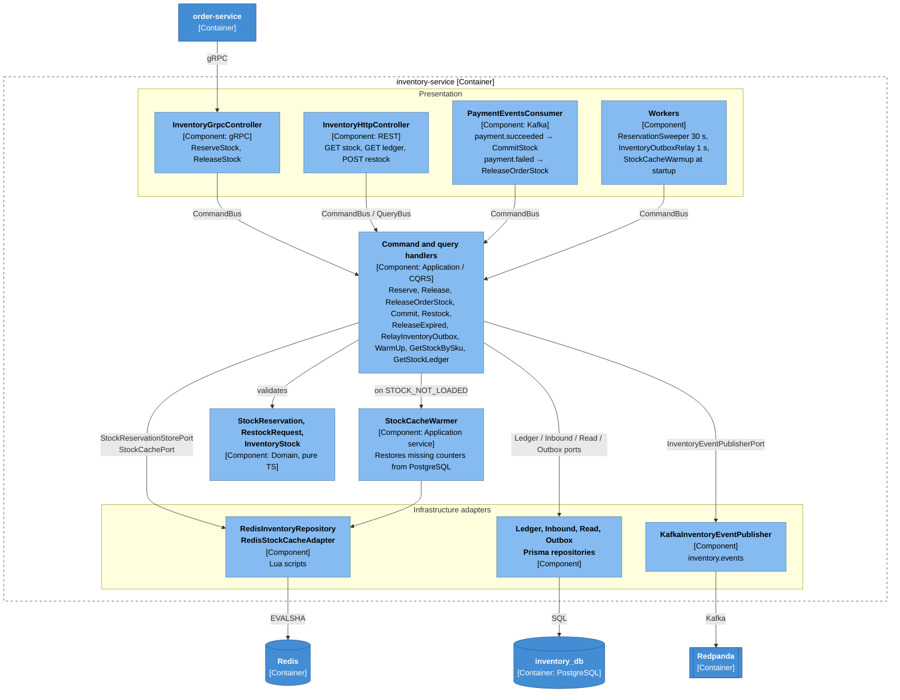

### 3.5 Level 3 — Components of payment-service

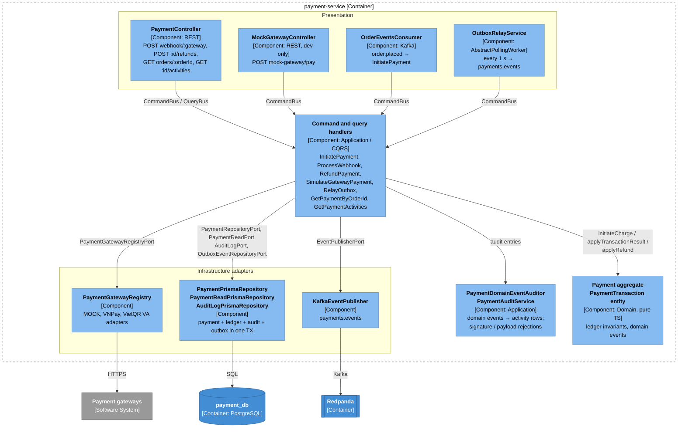

### 3.6 Code structure (per service)

```
apps/<service>/src
├── domain/           pure TypeScript: aggregates, value objects, domain events, errors, repository ports
├── application/      CQRS commands/queries + handlers, outbound ports, read models
├── infrastructure/   Prisma, Redis (Lua), gRPC client, Kafka, payment gateway adapters
├── presentation/     REST controllers, gRPC controller, Kafka consumers, background workers
└── core/             global filters (DomainError → HTTP / gRPC status)
libs/
├── shared/domain          shared kernel (ValueObject, Entity, AggregateRoot, Result, DomainError)
├── shared/infrastructure  readEnv, RedisService, AbstractPrismaService, outbox SQL, AbstractPollingWorker, Swagger
├── shared/messaging       Kafka client (Snappy), topic manager, idempotent producer, base consumer
├── contracts              integration event payloads, envelope, topics, event types
└── proto                  inventory.proto (gRPC contract)
```

ESLint enforces the dependency rule: `src/domain/**` and `type:domain` libraries cannot import NestJS,
Prisma, Redis, Kafka, gRPC, class-validator or rxjs, nor the outer layers.

## 4. End-to-end checkout flow (saga choreography)

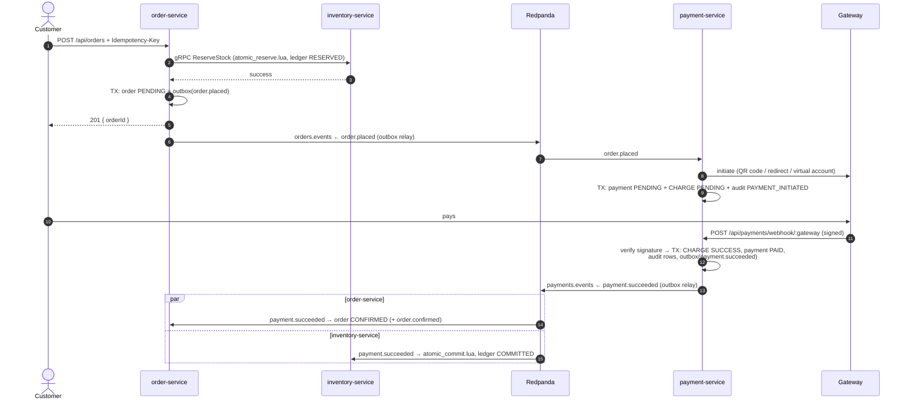

On `payment.failed` the order is `CANCELLED` and the inventory runs `atomic_release.lua` at once (ledger
`RELEASED`) instead of waiting for the reservation to expire. Details: [message flows 08–11](./message-flows/README.md).

## 5. Data model

### 5.1 order_db

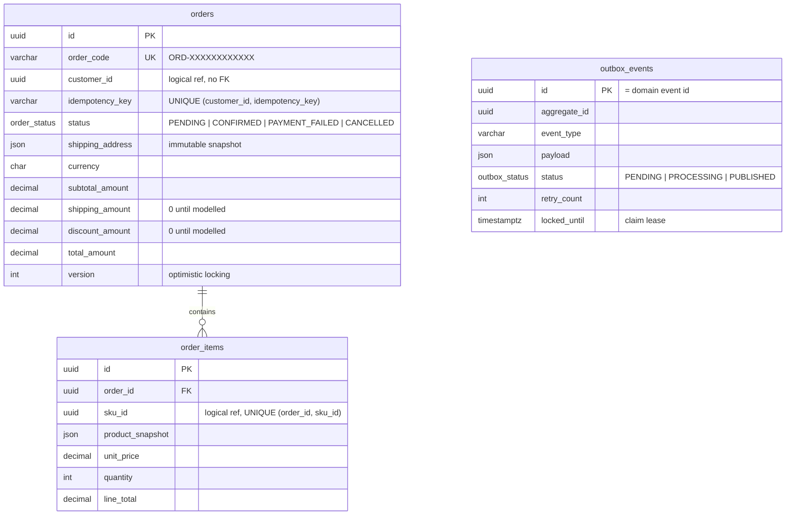

### 5.2 inventory_db

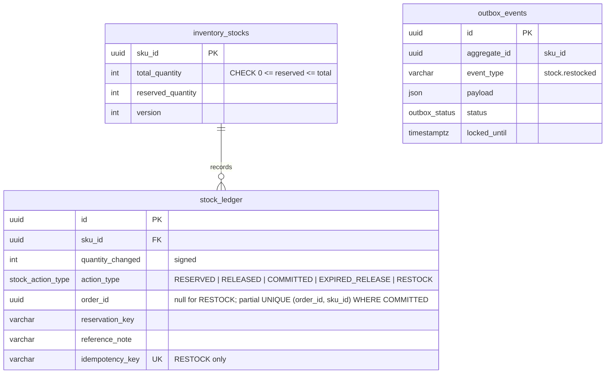

### 5.3 payment_db

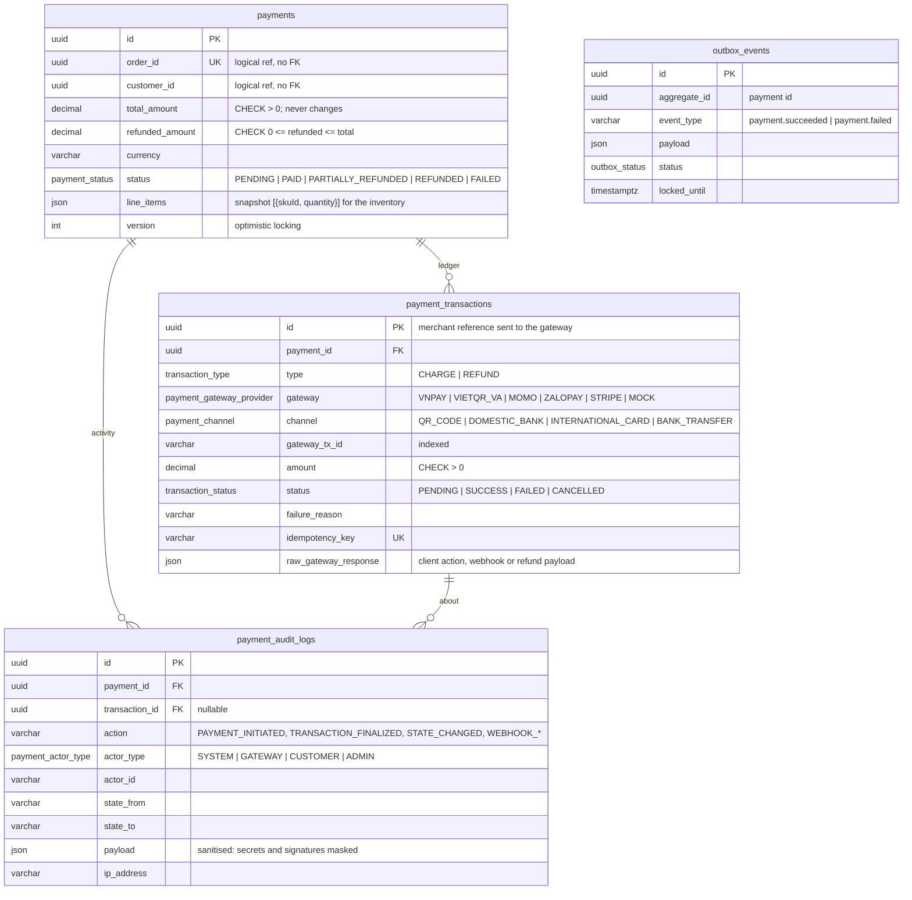

`payment_transactions` has no `updated_at`: a row is inserted, and a PENDING row is finalised once. Triggers enforce
it (§7.5). Ledger keys: `charge:{order.placed event id}` and `refund:{paymentId}:{Idempotency-Key}`.

### 5.4 Redis keys

| Key                                      | Type   | Content                                                                          | Lifetime                                                                    |
| ---------------------------------------- | ------ | -------------------------------------------------------------------------------- | --------------------------------------------------------------------------- |
| `idempotency:order:{customerId}:{key}`   | string | `PROCESSING` → `COMPLETED`                                                       | 120 s while processing, 24 h when completed; deleted on failure (Lua guard) |
| `inventory:stock:{skuId}`                | hash   | `total`, `reserved`                                                              | **No TTL** — source of truth for the Lua scripts                            |
| `inventory:reservation:{reservationKey}` | hash   | `status` (`RESERVED`/`COMMITTED`), `orderId`, `items`, `expiresAt`, `commitMode` | 7 days (garbage collection only)                                            |
| `inventory:reservation_order:{orderId}`  | string | reservation key                                                                  | 7 days                                                                      |
| `inventory:reservation_expirations`      | ZSET   | member = reservation key, score = expiry (epoch ms, Redis clock)                 | Until committed/released                                                    |
| `inventory:applied_restock:{eventId}`    | string | marker                                                                           | 30 days                                                                     |

Reservation keys are `{customerId}:{Idempotency-Key}`, so retries of the same checkout reuse the same reservation.

## 6. Messaging

| Topic              | Key       | Partitions | Producer                             | Consumer groups                                                    | Events                                               |
| ------------------ | --------- | ---------- | ------------------------------------ | ------------------------------------------------------------------ | ---------------------------------------------------- |
| `orders.events`    | `orderId` | 3          | order-service (outbox relay)         | `payment-consumer-group`                                           | `order.placed`, `order.confirmed`, `order.cancelled` |
| `payments.events`  | `orderId` | 3          | payment-service (outbox relay)       | `order-payment-consumer-group`, `inventory-payment-consumer-group` | `payment.succeeded`, `payment.failed`                |
| `inventory.events` | `orderId` | 3          | inventory-service (direct, see §7.4) | `order-consumer-group`                                             | `stock.reservation_failed`                           |

A service consuming two topics uses one group per topic: the members of a group must subscribe to the same
topics. `payment.succeeded` / `payment.failed` carry the order lines (`items`), so the inventory can still commit
or release when the reservation has expired.

Every message value is an `IntegrationEventEnvelope` `{ eventId, eventType, aggregateId, occurredAt, payload }`
(`libs/contracts`). Producers are idempotent with one in-flight request, `acks=all`, Snappy compression.
Consumers never auto-create topics; both sides create them with the configured partition count.

Internal (non-Kafka) events: `stock.restocked` lives only in the inventory outbox and is applied to Redis. Payment
domain events (`payment.initiated`, `payment.transaction_finalized`, `payment.status_changed`) feed the activity log;
only transitions to PAID / FAILED reach the outbox. Refunds are not published yet.

## 7. Consistency patterns

### 7.1 Atomic stock operations (Lua)

| Script               | Purpose                                                                      | Replies                                                                                           |
| -------------------- | ---------------------------------------------------------------------------- | ------------------------------------------------------------------------------------------------- |
| `atomic_reserve.lua` | Check all lines, reserve all or none, schedule expiry, index by order        | 1 reserved · 0 insufficient · 2 already reserved · 3 stock not loaded                             |
| `atomic_release.lua` | Release a `RESERVED` reservation (compensation / expiry)                     | 1 released · 0 not found / committed                                                              |
| `atomic_commit.lua`  | Ship stock; late commit re-acquires if available                             | {1} committed · {2} already · {3} re-acquired · {0} expired & out of stock · {4} stock not loaded |
| `warm_stock.lua`     | Restore a missing hash from a PG snapshot; mark its pending receipts applied | 1 restored · 0 existed                                                                            |
| `apply_restock.lua`  | Add a receipt exactly once per event                                         | 1 applied · 2 already · 0 SKU not cached                                                          |

Measured: 200 concurrent 1-unit reservations against 100 units → exactly 100 succeed.

### 7.2 Transactional outbox

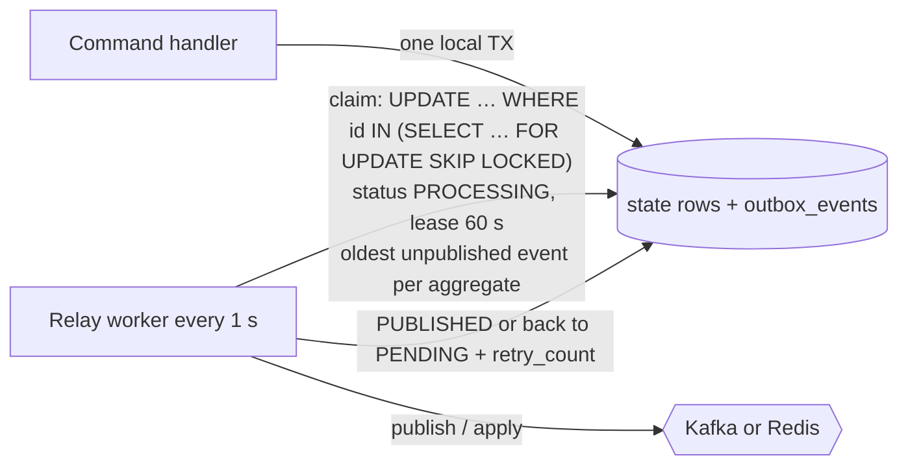

- Shared statements: `claimOutboxBatch`, `markOutboxPublished`, `markOutboxFailed` (`@org/shared-infrastructure`).
- Safe with several instances; a crashed relay's rows become claimable when the lease expires.
- Delivery is **at-least-once**: every consumer is idempotent (event id, Redis markers, DB unique keys).

### 7.3 Idempotency

| Operation                        | Mechanism                                                                                    |
| -------------------------------- | -------------------------------------------------------------------------------------------- |
| `POST /orders`                   | Redis `SET NX EX` per customer + key; DB `UNIQUE (customer_id, idempotency_key)` as backstop |
| `ReserveStock`                   | Reservation hash per `{customerId}:{key}`; replay returns `ALREADY_RESERVED`                 |
| `ReleaseStock`                   | Only acts while `RESERVED`                                                                   |
| `order.placed` consumption       | payment-service: `payments.order_id` UNIQUE + ledger key `charge:{eventId}`                  |
| `payment.succeeded` consumption  | inventory: `COMMITTED` marker in Redis + partial unique index; order: already `CONFIRMED`    |
| `payment.failed` consumption     | inventory: release only acts while `RESERVED`; order: already `CANCELLED`                    |
| Gateway webhook                  | A final charge acknowledges retries with 200; concurrent deliveries → version conflict (409) |
| `POST /payments/:id/refunds`     | Ledger key `refund:{paymentId}:{Idempotency-Key}`: a replay returns the recorded refund      |
| `POST /inventory/stocks/restock` | `stock_ledger.idempotency_key` UNIQUE → 409                                                  |
| `stock.restocked` apply          | `inventory:applied_restock:{eventId}` marker, atomic with `HINCRBY`                          |

### 7.4 Deliberate exceptions

- `stock.reservation_failed` is published directly (not via an outbox): the inventory path that emits it changes
  no local state, and a failed publish makes the consumer rethrow so Kafka redelivers `order.placed`.
- The payment gateway is called before the payment is stored (to get the customer action); if the store fails the
  checkout session at the gateway simply expires unused.
- Order creation calls inventory synchronously (gRPC) to give the customer an immediate answer; compensation
  (`ReleaseStock`) runs if persisting the order fails, except on a duplicate key (the reservation then belongs
  to the order already stored).

### 7.5 Append-only payment ledger and activity log

| Guarantee                                                | Domain (`Payment`, `PaymentTransaction`)              | Database (triggers / CHECK, init migration)                                  |
| -------------------------------------------------------- | ----------------------------------------------------- | ---------------------------------------------------------------------------- |
| A final entry (SUCCESS, FAILED, CANCELLED) never changes | `finalize` throws `TransactionAlreadyFinalizedError`  | `payment_transactions_guard`: UPDATE / DELETE of a final row raises          |
| A PENDING entry only gets its outcome                    | No setters; `finalize` once                           | Same trigger: id, payment, type, gateway, amount, key, created_at are frozen |
| The activity log is never changed                        | Rows are only appended                                | `payment_audit_logs_guard`: every UPDATE / DELETE raises                     |
| No bulk wipe                                             | —                                                     | `BEFORE TRUNCATE` triggers on both tables                                    |
| `totalAmount` never changes; refunds never exceed it     | `applyRefund` / `checkRefund` invariants              | `payments_refunded_amount_range` CHECK                                       |
| A success captures exactly the charged amount            | `AmountMismatchError` (audited as `WEBHOOK_REJECTED`) | —                                                                            |

The repository inserts new ledger rows and finalises PENDING rows with `UPDATE … WHERE status = 'PENDING'`; payment
row, ledger rows, activity rows and outbox rows are written in one `$transaction`. Activity rows come from the domain
events through synchronous audit handlers, so they commit or roll back with the change they describe. Protocol
events that change nothing (bad signature, malformed payload, gateway refusal) are appended by `PaymentAuditService`
with the caller IP and sanitised request metadata.

### 7.6 Payment gateways (strategy)

| Adapter                  | Customer action                    | Webhook verification                                            | Refund / status query                         |
| ------------------------ | ---------------------------------- | --------------------------------------------------------------- | --------------------------------------------- |
| `MockGatewayAdapter`     | QR code, redirect, virtual account | HMAC-SHA256 of the raw body, `x-webhook-signature`              | Instant (reason `MOCK_REFUND_DECLINED` fails) |
| `VnpayGatewayAdapter`    | Redirect, signed `vnp_Command=pay` | HMAC-SHA512 over sorted `vnp_` params; 00 success, 24 cancelled | Skeleton: signed refund prepared, 501         |
| `VietqrVaGatewayAdapter` | Virtual account                    | HMAC-SHA256 of the raw body, `x-vietqr-signature`               | Not supported (manual), 501                   |

Signatures are compared in constant time (`timingSafeEqual`). The webhook route keeps the raw body (`rawBody: true`)
because signatures cover the exact bytes; for IPNs without a body (VNPay) the query string is verified instead.

## 8. Failure modes

| Failure                                       | Effect                                                                              | Recovery                                                                                                 |
| --------------------------------------------- | ----------------------------------------------------------------------------------- | -------------------------------------------------------------------------------------------------------- |
| Kafka down                                    | Orders still accepted; outbox rows stay `PENDING`, `retry_count` grows              | Relay publishes in order once Kafka is back                                                              |
| Redis down                                    | `POST /orders` fails (idempotency + reservation need Redis); restock still succeeds | Inventory outbox relay applies receipts once Redis is back                                               |
| Redis data loss                               | Stock hashes missing                                                                | `STOCK_NOT_LOADED` → restore from PG + retry; startup warm-up                                            |
| order-service crashes after reserving         | Reservation stays `RESERVED`                                                        | Compensating `ReleaseStock`, otherwise sweeper releases it after 15 min                                  |
| Payment arrives after the reservation expired | Reservation already released                                                        | Late commit re-acquires stock, or `stock.reservation_failed` (order may already be `CONFIRMED`, see §10) |
| Webhook arrives before the payment exists     | `order.placed` not consumed yet                                                     | 404; the gateway retries                                                                                 |
| Duplicate / concurrent webhooks               | Same result delivered twice                                                         | Final charge → 200 unchanged; concurrent → 409, retry acknowledged                                       |
| Forged or altered webhook                     | Signature mismatch                                                                  | 401 + `WEBHOOK_SIGNATURE_MISMATCH` in the activity log                                                   |
| Relay crash after publish/apply               | Duplicate delivery                                                                  | Idempotent consumers / markers                                                                           |
| inventory DB write fails after Lua            | Redis ahead of PG                                                                   | Reserve: Lua compensation; commit: ledger reconciliation on redelivery                                   |

## 9. Configuration and process roles

| Variable                                                                                   | Service      | Default                  | Purpose                                                    |
| ------------------------------------------------------------------------------------------ | ------------ | ------------------------ | ---------------------------------------------------------- |
| `DATABASE_URL`                                                                             | all          | **required**             | PostgreSQL connection (fail fast + `SELECT 1` probe)       |
| `REDIS_URL`                                                                                | order, inv.  | `redis://localhost:6379` | Redis                                                      |
| `KAFKA_BROKERS`                                                                            | all          | `localhost:9092`         | Redpanda                                                   |
| `INVENTORY_GRPC_HOST` / `_PORT`                                                            | order / inv. | `localhost` / `50051`    | gRPC                                                       |
| `HTTP_ENABLED`                                                                             | all          | `true`                   | HTTP (and gRPC on inventory); `false` = worker-only pod    |
| `OUTBOX_RELAY_ENABLED`, `OUTBOX_RELAY_INTERVAL_MS`                                         | all          | `true`, 1000             | Outbox relay                                               |
| `KAFKA_CONSUMERS_ENABLED`                                                                  | all          | `true`                   | Kafka consumers                                            |
| `RESERVATION_SWEEPER_ENABLED`, `RESERVATION_SWEEP_INTERVAL_MS`, `RESERVATION_TTL_SECONDS`  | inventory    | `true`, 30000, 900       | Expiry                                                     |
| `STOCK_CACHE_WARMUP_ENABLED`                                                               | inventory    | `true`                   | Startup warm-up                                            |
| `PAYMENT_DEFAULT_GATEWAY`, `PAYMENT_DEFAULT_CHANNEL`                                       | payment      | `MOCK`, `QR_CODE`        | Gateway and channel of new payments                        |
| `MOCK_GATEWAY_SECRET`, `MOCK_GATEWAY_BASE_URL`                                             | payment      | required when used       | MOCK webhook HMAC secret, checkout URLs                    |
| `MOCK_GATEWAY_ENABLED`                                                                     | payment      | `true`                   | `POST /payments/mock-gateway/pay`; **false in production** |
| `VNPAY_TMN_CODE`, `VNPAY_HASH_SECRET`, `VNPAY_RETURN_URL`, `VNPAY_PAYMENT_URL`             | payment      | required when used       | VNPay adapter                                              |
| `VIETQR_WEBHOOK_SECRET`, `VIETQR_BANK_BIN`, `VIETQR_ACCOUNT_PREFIX`, `VIETQR_ACCOUNT_NAME` | payment      | required when used       | VietQR virtual-account adapter                             |
| `SWAGGER_ENABLED`                                                                          | all          | `true`                   | `/api/docs`, `/api/docs-json`                              |

The same image can run as API pods (`OUTBOX_RELAY_ENABLED=false`, `KAFKA_CONSUMERS_ENABLED=false`) or worker
pods (`HTTP_ENABLED=false`). Images are multi-stage (`build` → `migrate` → `runtime`), non-root, with health checks.

## 10. Known limitations and next steps

| Area             | Limitation                                                                                  | Direction                                                    |
| ---------------- | ------------------------------------------------------------------------------------------- | ------------------------------------------------------------ |
| Security         | No authentication; `GET /orders?customerId=` and refunds are open (`x-actor-id` is trusted) | API gateway / BFF with JWT, roles for refunds                |
| Pricing          | `unitPrice` and `productName` come from the client                                          | Catalog / pricing service                                    |
| Late payments    | A payment after the 15-min reservation may be confirmed while stock is gone                 | Refund saga on `stock.reservation_failed`; expire checkouts  |
| Refund events    | Refunds are audited but not published; stock is not restocked on refund                     | `payment.refunded` event, returns flow                       |
| Gateways         | VNPay refund / `querydr` client and IPN `RspCode` reply not wired; VietQR has no refunds    | Merchant web API clients; reconciliation job (`queryStatus`) |
| Unattached audit | A forged webhook naming no known charge is only logged (every row belongs to a payment)     | Separate security log                                        |
| Cancellation     | `order.cancelled` is not consumed by inventory                                              | Release committed / reserved stock on customer cancellation  |
| Redis total loss | Active reservations are lost; their `reserved` units stay counted                           | Rebuild reservations from the ledger                         |
| Redis Cluster    | Scripts touch several keys                                                                  | Hash tags per SKU / reservation                              |
| Outbox markers   | `applied_restock` markers expire after 30 days                                              | Alert on outbox rows pending longer than minutes             |
