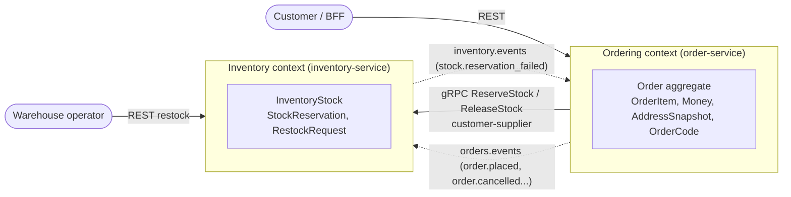
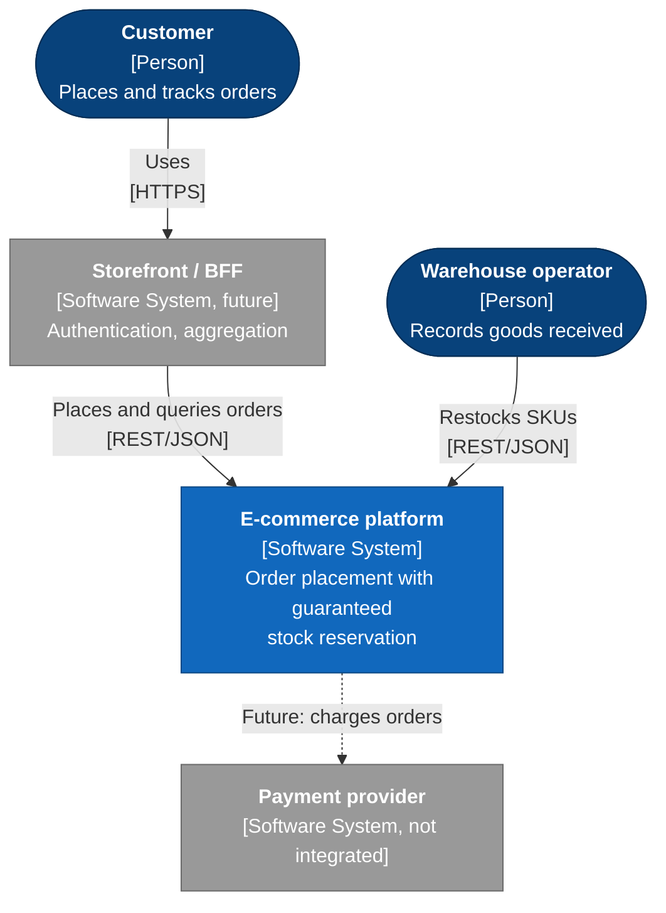
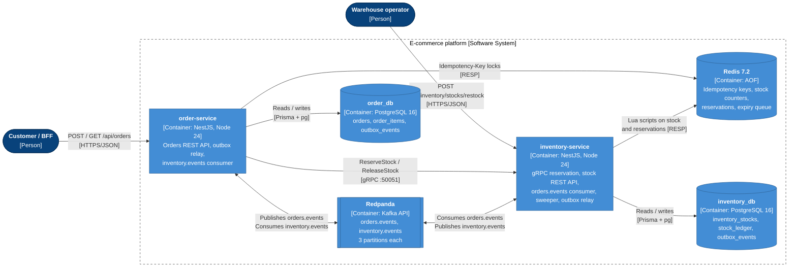
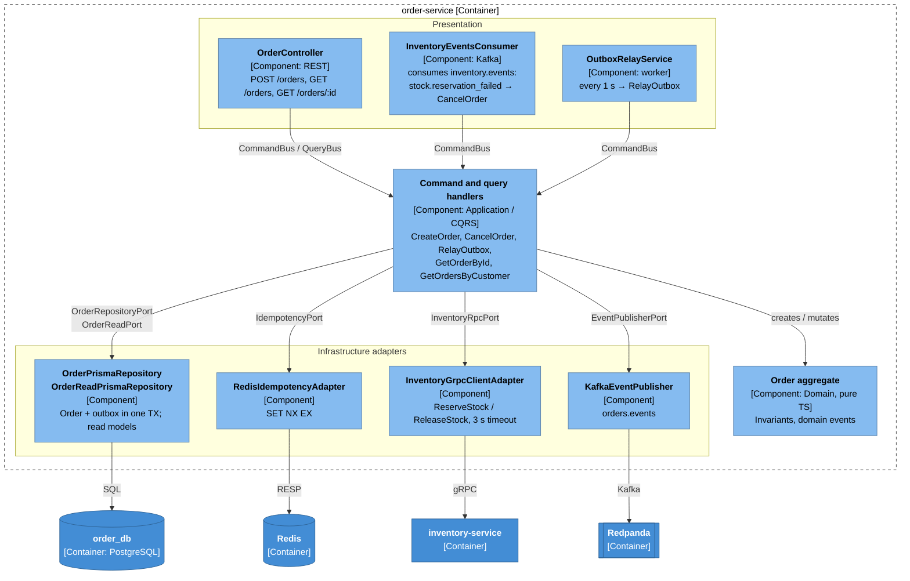
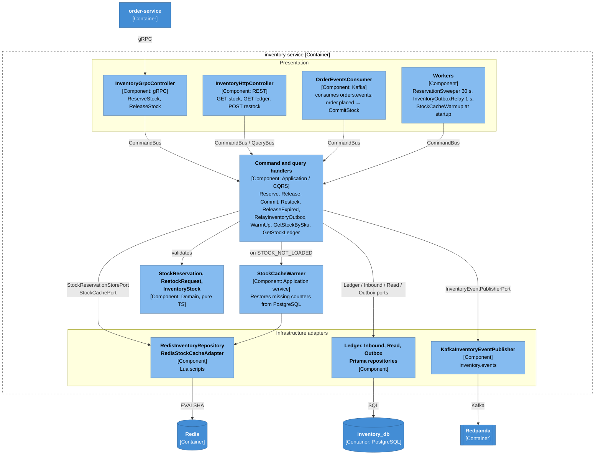
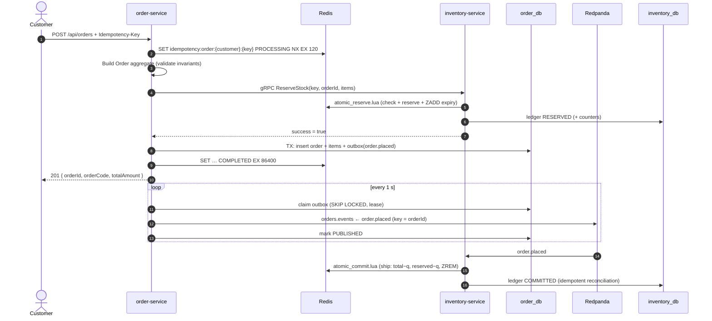
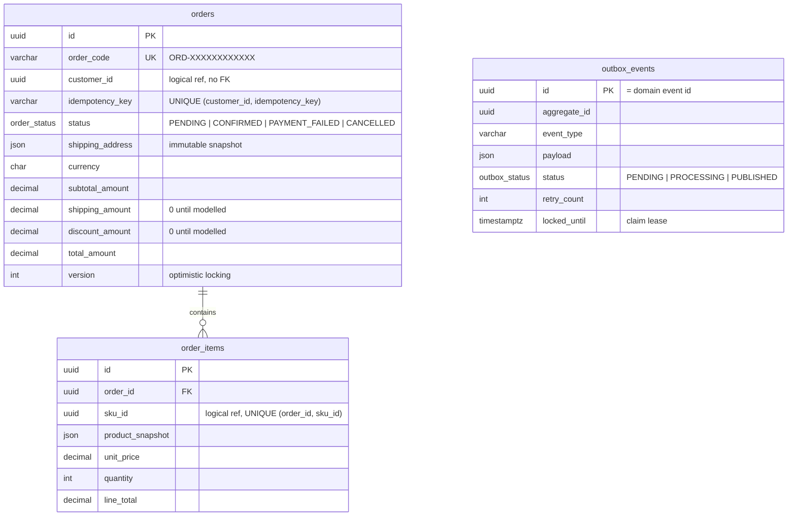
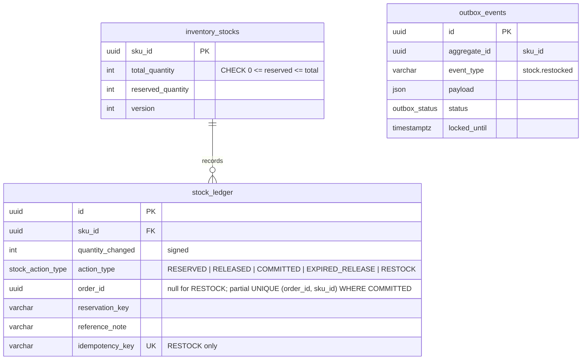
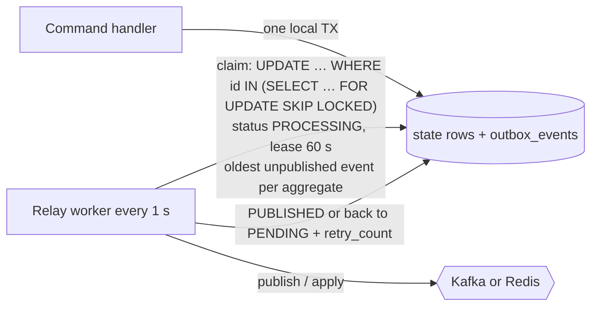

# System Design — NestJS E-commerce (Order & Inventory)

> Status: reflects the code on branch `feat/order-service` (commit `f137d50` and later).
> Per-feature message flows live in [`message-flows/`](./message-flows/README.md).

## 1. Scope and goals

The system takes customer orders and guarantees that **stock is never oversold**, even under concurrent
checkouts, crashes, retries and partial outages of Redis or Kafka.

| Goal                             | How it is achieved                                                                           |
| -------------------------------- | -------------------------------------------------------------------------------------------- |
| No overselling under concurrency | Stock checks and changes run as atomic Lua scripts on Redis (CLAUDE.md §4.1)                 |
| No lost or phantom events        | Transactional outbox in both services (CLAUDE.md §4.2)                                       |
| Safe retries                     | `Idempotency-Key` on every state-changing request, Redis `SET NX EX` + DB unique keys (§4.3) |
| Service autonomy                 | Database per service, no cross-service joins or FKs, logical UUIDs and JSON snapshots (§4.4) |
| No stuck stock                   | Reservations expire (ZSET + sweeper) unless the order is committed                           |
| Recoverable cache                | Redis counters are restored from PostgreSQL on demand and at startup                         |

Out of scope today: payments, customers/catalog services, authentication, shipping.

## 2. Bounded contexts



| Relationship                           | Pattern                                                                           |
| -------------------------------------- | --------------------------------------------------------------------------------- |
| Ordering → Inventory (reserve/release) | Synchronous customer–supplier over gRPC, contract in `libs/proto/inventory.proto` |
| Ordering ⇄ Inventory (events)          | Published language: `@org/contracts` (payloads, envelope, topic names)            |
| Shared kernel                          | `@org/shared-domain` (ValueObject, Entity, AggregateRoot, Result, DomainError)    |

## 3. C4 model

### 3.1 Level 1 — System context



### 3.2 Level 2 — Containers



| Container          | Inbound                                                         | Outbound                                           | Ports (local)                              |
| ------------------ | --------------------------------------------------------------- | -------------------------------------------------- | ------------------------------------------ |
| order-service      | REST `/api/orders`, `inventory.events`                          | gRPC → inventory, `orders.events`, order_db, Redis | HTTP 3100, Swagger `/api/docs`             |
| inventory-service  | gRPC `InventoryService`, REST `/api/inventory`, `orders.events` | `inventory.events`, inventory_db, Redis            | HTTP 3200, gRPC 50051                      |
| PostgreSQL         | —                                                               | —                                                  | 5433 (host), 5432 (compose network)        |
| Redis              | —                                                               | —                                                  | 6379                                       |
| Redpanda / Console | —                                                               | —                                                  | 9092 (host), 29092 (compose), Console 8088 |

### 3.3 Level 3 — Components of order-service



### 3.4 Level 3 — Components of inventory-service



### 3.5 Code structure (per service)

```
apps/<service>/src
├── domain/           pure TypeScript: aggregates, value objects, domain events, errors, repository ports
├── application/      CQRS commands/queries + handlers, outbound ports, read models
├── infrastructure/   Prisma, Redis (Lua), gRPC client, Kafka adapters
├── presentation/     REST controllers, gRPC controller, Kafka consumers, background workers
└── core/             global filters (DomainError → HTTP / gRPC status)
libs/
├── shared/domain          shared kernel (ValueObject, Entity, AggregateRoot, Result, DomainError)
├── shared/infrastructure  readEnv, RedisService, AbstractPrismaService, outbox SQL, AbstractPollingWorker, Swagger
├── shared/messaging       Kafka client (Snappy), topic manager, idempotent producer, base consumer
├── contracts              integration event payloads, envelope, topics, event types
└── proto                  inventory.proto (gRPC contract)
```

ESLint enforces the dependency rule: `src/domain/**` and `type:domain` libraries cannot import NestJS,
Prisma, Redis, Kafka, gRPC, class-validator or rxjs, nor the outer layers.

## 4. End-to-end checkout flow



## 5. Data model

### 5.1 order_db



### 5.2 inventory_db



### 5.3 Redis keys

| Key                                      | Type   | Content                                                                          | Lifetime                                                                    |
| ---------------------------------------- | ------ | -------------------------------------------------------------------------------- | --------------------------------------------------------------------------- |
| `idempotency:order:{customerId}:{key}`   | string | `PROCESSING` → `COMPLETED`                                                       | 120 s while processing, 24 h when completed; deleted on failure (Lua guard) |
| `inventory:stock:{skuId}`                | hash   | `total`, `reserved`                                                              | **No TTL** — source of truth for the Lua scripts                            |
| `inventory:reservation:{reservationKey}` | hash   | `status` (`RESERVED`/`COMMITTED`), `orderId`, `items`, `expiresAt`, `commitMode` | 7 days (garbage collection only)                                            |
| `inventory:reservation_order:{orderId}`  | string | reservation key                                                                  | 7 days                                                                      |
| `inventory:reservation_expirations`      | ZSET   | member = reservation key, score = expiry (epoch ms, Redis clock)                 | Until committed/released                                                    |
| `inventory:applied_restock:{eventId}`    | string | marker                                                                           | 30 days                                                                     |

Reservation keys are `{customerId}:{Idempotency-Key}`, so retries of the same checkout reuse the same reservation.

## 6. Messaging

| Topic              | Key       | Partitions | Producer                             | Consumer group             | Events                                               |
| ------------------ | --------- | ---------- | ------------------------------------ | -------------------------- | ---------------------------------------------------- |
| `orders.events`    | `orderId` | 3          | order-service (outbox relay)         | `inventory-consumer-group` | `order.placed`, `order.confirmed`, `order.cancelled` |
| `inventory.events` | `orderId` | 3          | inventory-service (direct, see §7.4) | `order-consumer-group`     | `stock.reservation_failed`                           |

Every message value is an `IntegrationEventEnvelope` `{ eventId, eventType, aggregateId, occurredAt, payload }`
(`libs/contracts`). Producers are idempotent with one in-flight request, `acks=all`, Snappy compression.
Consumers never auto-create topics; both sides create them with the configured partition count.

Internal (non-Kafka) events: `stock.restocked` lives only in the inventory outbox and is applied to Redis.

## 7. Consistency patterns

### 7.1 Atomic stock operations (Lua)

| Script               | Purpose                                                                      | Replies                                                                                           |
| -------------------- | ---------------------------------------------------------------------------- | ------------------------------------------------------------------------------------------------- |
| `atomic_reserve.lua` | Check all lines, reserve all or none, schedule expiry, index by order        | 1 reserved · 0 insufficient · 2 already reserved · 3 stock not loaded                             |
| `atomic_release.lua` | Release a `RESERVED` reservation (compensation / expiry)                     | 1 released · 0 not found / committed                                                              |
| `atomic_commit.lua`  | Ship stock; late commit re-acquires if available                             | {1} committed · {2} already · {3} re-acquired · {0} expired & out of stock · {4} stock not loaded |
| `warm_stock.lua`     | Restore a missing hash from a PG snapshot; mark its pending receipts applied | 1 restored · 0 existed                                                                            |
| `apply_restock.lua`  | Add a receipt exactly once per event                                         | 1 applied · 2 already · 0 SKU not cached                                                          |

Measured: 200 concurrent 1-unit reservations against 100 units → exactly 100 succeed.

### 7.2 Transactional outbox



- Shared statements: `claimOutboxBatch`, `markOutboxPublished`, `markOutboxFailed` (`@org/shared-infrastructure`).
- Safe with several instances; a crashed relay's rows become claimable when the lease expires.
- Delivery is **at-least-once**: every consumer is idempotent (event id, Redis markers, DB unique keys).

### 7.3 Idempotency

| Operation                        | Mechanism                                                                                    |
| -------------------------------- | -------------------------------------------------------------------------------------------- |
| `POST /orders`                   | Redis `SET NX EX` per customer + key; DB `UNIQUE (customer_id, idempotency_key)` as backstop |
| `ReserveStock`                   | Reservation hash per `{customerId}:{key}`; replay returns `ALREADY_RESERVED`                 |
| `ReleaseStock`                   | Only acts while `RESERVED`                                                                   |
| `order.placed` consumption       | `COMMITTED` marker in Redis + partial unique index on the ledger                             |
| `POST /inventory/stocks/restock` | `stock_ledger.idempotency_key` UNIQUE → 409                                                  |
| `stock.restocked` apply          | `inventory:applied_restock:{eventId}` marker, atomic with `HINCRBY`                          |

### 7.4 Deliberate exceptions

- `stock.reservation_failed` is published directly (not via an outbox): the inventory path that emits it changes
  no local state, and a failed publish makes the consumer rethrow so Kafka redelivers `order.placed`.
- Order creation calls inventory synchronously (gRPC) to give the customer an immediate answer; compensation
  (`ReleaseStock`) runs if persisting the order fails, except on a duplicate key (the reservation then belongs
  to the order already stored).

## 8. Failure modes

| Failure                               | Effect                                                                              | Recovery                                                                                   |
| ------------------------------------- | ----------------------------------------------------------------------------------- | ------------------------------------------------------------------------------------------ |
| Kafka down                            | Orders still accepted; outbox rows stay `PENDING`, `retry_count` grows              | Relay publishes in order once Kafka is back                                                |
| Redis down                            | `POST /orders` fails (idempotency + reservation need Redis); restock still succeeds | Inventory outbox relay applies receipts once Redis is back                                 |
| Redis data loss                       | Stock hashes missing                                                                | `STOCK_NOT_LOADED` → restore from PG + retry; startup warm-up                              |
| order-service crashes after reserving | Reservation stays `RESERVED`                                                        | Compensating `ReleaseStock`, otherwise sweeper releases it after 15 min                    |
| `order.placed` arrives after expiry   | Reservation already released                                                        | Late commit re-acquires stock, or publishes `stock.reservation_failed` → order `CANCELLED` |
| Relay crash after publish/apply       | Duplicate delivery                                                                  | Idempotent consumers / markers                                                             |
| inventory DB write fails after Lua    | Redis ahead of PG                                                                   | Reserve: Lua compensation; commit: ledger reconciliation on redelivery                     |

## 9. Configuration and process roles

| Variable                                                                                  | Service      | Default                  | Purpose                                                 |
| ----------------------------------------------------------------------------------------- | ------------ | ------------------------ | ------------------------------------------------------- |
| `DATABASE_URL`                                                                            | both         | **required**             | PostgreSQL connection (fail fast + `SELECT 1` probe)    |
| `REDIS_URL`                                                                               | both         | `redis://localhost:6379` | Redis                                                   |
| `KAFKA_BROKERS`                                                                           | both         | `localhost:9092`         | Redpanda                                                |
| `INVENTORY_GRPC_HOST` / `_PORT`                                                           | order / both | `localhost` / `50051`    | gRPC                                                    |
| `HTTP_ENABLED`                                                                            | both         | `true`                   | HTTP (and gRPC on inventory); `false` = worker-only pod |
| `OUTBOX_RELAY_ENABLED`, `OUTBOX_RELAY_INTERVAL_MS`                                        | both         | `true`, 1000             | Outbox relay                                            |
| `KAFKA_CONSUMERS_ENABLED`                                                                 | both         | `true`                   | Kafka consumers                                         |
| `RESERVATION_SWEEPER_ENABLED`, `RESERVATION_SWEEP_INTERVAL_MS`, `RESERVATION_TTL_SECONDS` | inventory    | `true`, 30000, 900       | Expiry                                                  |
| `STOCK_CACHE_WARMUP_ENABLED`                                                              | inventory    | `true`                   | Startup warm-up                                         |
| `SWAGGER_ENABLED`                                                                         | both         | `true`                   | `/api/docs`, `/api/docs-json`                           |

The same image can run as API pods (`OUTBOX_RELAY_ENABLED=false`, `KAFKA_CONSUMERS_ENABLED=false`) or worker
pods (`HTTP_ENABLED=false`). Images are multi-stage (`build` → `migrate` → `runtime`), non-root, with health checks.

## 10. Known limitations and next steps

| Area             | Limitation                                                                                  | Direction                                                   |
| ---------------- | ------------------------------------------------------------------------------------------- | ----------------------------------------------------------- |
| Security         | No authentication; `GET /orders?customerId=` exposes any customer's orders; restock is open | API gateway / BFF with JWT, scope orders to the caller      |
| Pricing          | `unitPrice` and `productName` come from the client                                          | Catalog / pricing service                                   |
| Payment          | `confirm()` exists but nothing triggers it                                                  | Payment service + saga                                      |
| Cancellation     | `order.cancelled` is not consumed by inventory                                              | Release committed / reserved stock on customer cancellation |
| Late events      | A late `order.placed` with stock gone cancels the order after acceptance                    | Notify the customer; extend reservation TTL                 |
| Redis total loss | Active reservations are lost; their `reserved` units stay counted                           | Rebuild reservations from the ledger                        |
| Redis Cluster    | Scripts touch several keys                                                                  | Hash tags per SKU / reservation                             |
| Outbox markers   | `applied_restock` markers expire after 30 days                                              | Alert on outbox rows pending longer than minutes            |
